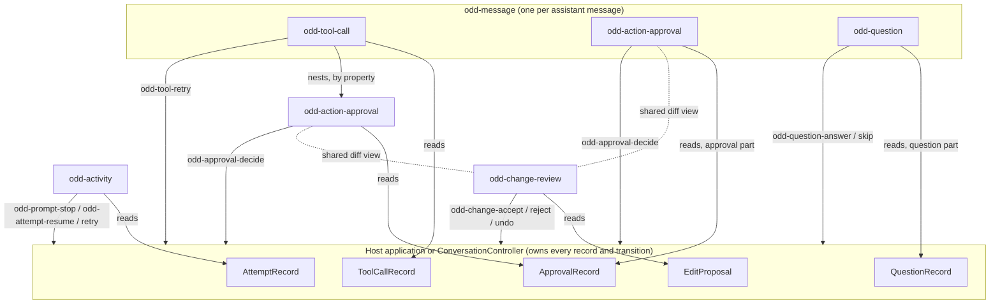

# 0049. Agent workflow elements: one owner per fact, composed around the records

- **Status:** Proposed (2026-11-08). The record and state changes that need no further owner decision (§6 items 1, 2, and 5, item 3's diff view, and the renames of §5) can start now; permission scopes (§6 item 3) and questions in the conversation (§6 item 4) wait for the owner's confirmation. The visual redesign of `odd-action-approval` and its neighbours waits for the owner's Figma designs (owner, 2026-11-08, to Agent 2: "hold off on any new redesigns until those Figmas are drawn").
- **Date:** 2026-11-08
- **Area:** `@oddkin/ai`: `odd-action-approval`, `odd-tool-call`, `odd-change-review`, `odd-activity`, `odd-question`, their records, the conversation controller, and the adapters
- **Builds on:** [ai-interaction.md](../ai-interaction.md) §1 (records are host-owned; elements own presentation only), §4.4 to §4.6 (lifecycles); [the component architecture audit](../../research/component-architecture-audit.md) (approved 2026-11-06)
- **Checked against:** `main` at `2a46230` (2026-11-08)

## Context

The owner asked, before `odd-action-approval` is redesigned, whether the five elements that carry an agent's work and a person's part in it form one vocabulary or five overlapping ones. Oddkin has no production users, so breaking changes are allowed when they make the architecture clearer, without compatibility layers.

### The records today

Every one of these elements renders host-owned records and sends intents; none keeps workflow state of its own ([ai-interaction.md](../ai-interaction.md) §1). The records are:

| Record | Where | Status values |
| --- | --- | --- |
| `ToolCallRecord` | [contracts/models.ts:122–152](../../../packages/ai/src/contracts/models.ts#L122-L152) | `input-streaming`, `input-available`, `awaiting-approval`, `executing`, `output-available`, `output-error`, `denied`, `cancelled`; `approvalId` links its approval |
| `ApprovalRecord` | [contracts/models.ts:164–191](../../../packages/ai/src/contracts/models.ts#L164-L191) | `requested`, `decision-pending`, `approved`, `rejected`, `expired`, `superseded`, `decision-failed`; `toolCallId` links its tool call; `changes` is a list of before and after strings |
| `QuestionRecord` | [contracts/models.ts:284–311](../../../packages/ai/src/contracts/models.ts#L284-L311) | `requested`, `submitting`, `submitted`, `skipped`, `expired`, `failed`; not part of `ConversationState` and not a message part |
| `EditProposal` | [controllers/document.ts:82–117](../../../packages/ai/src/controllers/document.ts#L82-L117) | `proposed`, `accept-pending`, `applied`, `rejected`, `stale`, `undo-pending`, `undone`, `failed`; edits the host applies to a document it owns |
| `AttemptRecord` | [contracts/types.ts:81–96](../../../packages/ai/src/contracts/types.ts#L81-L96) | `submitted`, `accepted`, `streaming`, `awaiting-input`, `completed`, `cancelled`, `failed`, `interrupted`, with the connection and stop states beside them |

### The elements today

| Element | Renders | Sends | Composes |
| --- | --- | --- | --- |
| `odd-action-approval` ([action-approval.ts](../../../packages/ai/src/action-approval/action-approval.ts)) | One `ApprovalRecord`: title, summary, target, risk, expiry, `changes` as `<del>`/`<ins>` text, status text, a reason field, Approve, Reject, Edit | `odd-approval-decide` (`approvalId`, `revision`, `toolCallId`, `decision`, `reason`), `odd-approval-edit`, `odd-announce` | `odd-button`; the internal `DecisionController` |
| `odd-tool-call` ([tool-call.ts](../../../packages/ai/src/tool-call/tool-call.ts)) | One `ToolCallRecord`: name, purpose, status, arguments, result or error, Retry | `odd-tool-retry` | `odd-action-approval`, from its `approval` property, after its own body ([tool-call.template.ts:58–64](../../../packages/ai/src/tool-call/tool-call.template.ts#L58-L64)) |
| `odd-change-review` ([change-review.ts](../../../packages/ai/src/change-review/change-review.ts)) | `EditProposal[]`: word or line diffs, inline or split, context; Accept, Reject or Dismiss, Undo | `odd-change-accept`, `odd-change-reject`, `odd-change-undo`, `odd-announce` | `odd-button`; `diffWords`/`diffLines` from [controllers/diff.ts](../../../packages/ai/src/controllers/diff.ts) |
| `odd-activity` ([activity.ts](../../../packages/ai/src/activity/activity.ts)) | One `AttemptRecord` and its `tools`: one status line; Stop, Resume, Retry | `odd-prompt-stop`, `odd-attempt-resume`, `odd-attempt-retry` | Native buttons |
| `odd-question` ([question.ts](../../../packages/ai/src/question/question.ts)) | One `QuestionRecord`: choices, a form, or free text; Answer, Skip | `odd-question-answer`, `odd-question-skip`, `odd-announce` | Native form controls; the internal `DecisionController` |

`odd-message` renders a `tool-call` part as `odd-tool-call`, looking up its approval by `tool.approvalId`, and an `approval` part as a standalone `odd-action-approval` ([message.template.ts:51–67](../../../packages/ai/src/message/message.template.ts#L51-L67)). The conversation controller puts an approval with a `toolCallId` on that tool call and moves the tool to `awaiting-approval`; an approval without one becomes an `approval` part ([conversation.ts:1016–1031](../../../packages/ai/src/controllers/conversation.ts#L1016-L1031)).

## What overlaps

| # | Overlap | Evidence | Effect |
| --- | --- | --- | --- |
| O1 | **Two records state one gate.** A tool's `awaiting-approval` and `denied` repeat what its approval's status says. | The controller moves the tool to `awaiting-approval` when the approval is requested ([conversation.ts:1021](../../../packages/ai/src/controllers/conversation.ts#L1021)) but never moves it when the approval resolves; only the adapter's next tool event does (`tool-denied`, [ui-message-stream.ts:312–314](../../../packages/ai/src/stream/ui-message-stream.ts#L312-L314)). | Between a decision and the adapter's next tool event, `odd-tool-call` says "Waiting for approval" above its own approval saying "Approved" or "Rejected", and `odd-activity` says "Waiting for approval" too. Two components contradict each other because two records hold one fact. |
| O2 | **A cross-record derivation in `odd-activity`.** | `_text()` scans `tools` for `awaiting-approval` ([activity.ts:80](../../../packages/ai/src/activity/activity.ts#L80)). | The run status depends on another element's record semantics, and it misses approvals outside tool calls and every question, although `AttemptStatus` already has `awaiting-input`. |
| O3 | **Two renderings of before and after.** | `odd-action-approval` prints `changes` as "Before: …"/"After: …" text ([action-approval.template.ts:45–58](../../../packages/ai/src/action-approval/action-approval.template.ts#L45-L58)); `odd-change-review` has word and line diffs, merged runs, context, inline and split views. | A proposed file write needs the review surface the approval cannot show, and the two drift apart. |
| O4 | **Four decision rows, built four times.** | Approve/Reject/Edit with a reason; Accept/Reject/Dismiss/Undo; Answer/Skip; Restore (checkpoint). Only the request guard and focus recovery are shared (`DecisionController`, since row 11). | Pending, disabled, loading, and failure presentation differ element by element. |
| O5 | **Three vocabularies for one lifecycle.** | Waiting for a person: `requested` (approval, question), `proposed` (proposal). In flight: `decision-pending`, `submitting`, `accept-pending`. Request failed: `decision-failed`, `failed`. | Hosts map the same idea three ways, and the status presentation cannot be shared. |
| O6 | **Status shown three ways.** | Toned text in the tool's summary, a toned paragraph in the approval, a status part per proposal, plain text in the question and the activity. | No consistent status reading across the vocabulary (the audit's row 12 already moves the tool's status to `odd-badge`). |
| O7 | **Human input enters the flow two ways.** | An approval is a record in `ConversationState` and a message part; a question is neither, so the host places `odd-question` outside the message flow and wires it by hand. | "An agent asks, then proposes" cannot be shown in order without host plumbing. |
| O8 | **No permission scope.** | `ApprovalRecord` and `ApprovalDecision` carry one decision for one revision; nothing lets a person approve "for this conversation" or "always for this tool". | Hosts that need it build a second approval UI. |

Not overlaps, after checking:

- **Approval and change review** decide different things: an approval authorizes an action that someone else executes (the agent's backend, a tool); a change review accepts edits that the host applies itself to a document it owns (`DocumentSession`). They share a review surface (O3), not a lifecycle.
- **Tool call and approval** stay separate records: an approval can exist without a tool call (`approval` parts: sending mail, spending money), and a tool call without an approval.
- **Activity and tool call** answer different questions: what the run is doing now, and what one call did.

## Decision

### 1. One owner per fact

The host, or the `ConversationController` acting for it, owns every record and every transition. Each fact lives in exactly one record; an element shows facts and derives presentation from the records it is given, never stores a copy, and never reaches into another element.

| Fact | Owner (record) | Presented by | Never stored in |
| --- | --- | --- | --- |
| May the action run? (authorization) | `ApprovalRecord.status` | `odd-action-approval`; `odd-tool-call` reads it to word its own gate | `ToolCallRecord` |
| What will change? (review) | `ApprovalRecord.changes` for an action; `EditProposal` for a host-applied edit | The shared diff view (§4) inside each | Either element's state |
| Did it run, and with what result? (execution) | `ToolCallRecord.status`, `output`, `error` | `odd-tool-call` | `ApprovalRecord` (approval never means success, §4.5) |
| What is the run doing? (progress) | `AttemptRecord` | `odd-activity` | `ToolCallRecord` scans |
| What does the agent need to know? (human input) | `QuestionRecord` | `odd-question` | Host-local state |

### 2. The relationships

- **Nested:** a tool call shows its own approval, because the approval gates that call. It is the one nesting in the vocabulary; it uses the `approval` property, not a slot, so there is one way to do it.
- **Siblings in the message flow:** a standalone approval (`approval` part) and a question (a new `question` part, §6 item 4) appear where the agent produced them, in order.
- **Outside the message:** `odd-activity` is the run's status bar; `odd-change-review` sits by the document it edits.
- **No element contains another's decision controls.** An approval never contains an `odd-change-review` (two decisions for one action would contradict); it shows its changes read-only through the shared diff view.

### 3. Each element's place

| Element | Classification | Disposition | Responsibility it keeps | What it gives up |
| --- | --- | --- | --- | --- |
| `odd-action-approval` | Specialized primitive | Refine | Authorization of one revision of one action: what, where, how risky, until when, which changes, and for which scope; the decision request and its outcome | Its own before and after rendering (to the shared diff view); its own decision row (to the shared one) |
| `odd-tool-call` | Composite | Refine | The invocation lifecycle: arguments, execution, result or error, retry; nesting its approval | The `awaiting-approval` status (derived from the approval) |
| `odd-change-review` | Composite | Refine | Review of edits the host applies to its own document: revisions, stale proposals, undo | Its private diff rendering, which becomes the shared view |
| `odd-activity` | Specialized primitive | Refine | The current run's status and its recovery actions | Scanning tool calls; "waiting" comes from the attempt alone |
| `odd-question` | Composite | Refine | Information the agent asks for, bound to a revision | Its place outside the message flow |

None is consolidated, internalized, or turned into a pattern:

- **Merging the approval into the tool call** would leave approvals outside tool calls without an element.
- **Merging the change review into the approval** would mix an action someone else runs with edits the host applies, which have different lifecycles (undo, staleness against the document).
- **Turning the activity into a pattern** would push the stop, resume, and retry rules into every application.

Each element earns its place through a contract (a revision-bound decision, an execution lifecycle, a document's revisions, a run's recovery), not through its layout.

### 4. Shared internals, not new public elements

These interactions repeat across the five. Each becomes one internal module of `@oddkin/ai`, used by every element that needs it. None becomes a public element: the components catalog does not grow (owner, 2026-10-29), and no consumer needs them outside these elements.

| Shared interaction | Module (internal) | Used by |
| --- | --- | --- |
| Diff view: word or line diffs, merged runs, context, inline or split, `<del>`/`<ins>` with visually hidden labels | `internal/diff-view.ts`, moved out of `odd-change-review` (`mergeRuns`, the diff template and styles), on `controllers/diff.ts` | `odd-change-review`, `odd-action-approval` (`changes`) |
| Decision row: native buttons drawn by `nativeButtonStyles`, the chosen button loading while the request is in flight, the others disabled, focus kept by `DecisionController` | `internal/decision-row.ts`, beside `internal/decision.ts`; lands with the redesign (§8), because one row changes the four elements' buttons | `odd-action-approval`, `odd-question`, `odd-change-review`, `odd-checkpoint` |
| Status: one vocabulary (§5) and one map from status to tone; `odd-badge` for compact status, a toned line for an outcome | `internal/status.ts` | All five, and `odd-checkpoint` |
| Expandable details | `odd-disclosure` (public, in `@oddkin/components`; its `summary` slot since row 12) | `odd-tool-call`; `odd-action-approval` for long changes |
| Expiry and times | `formatTime` (exists) | `odd-action-approval`, `odd-question` |

### 5. One lifecycle vocabulary for a person's decision

| Meaning | Approval | Question | Edit proposal (host-applied, so it keeps apply and undo) |
| --- | --- | --- | --- |
| Waiting for the person | `requested` | `requested` | `requested` (was `proposed`) |
| Request in flight | `submitting` (was `decision-pending`) | `submitting` | `applying` (was `accept-pending`), `undoing` (was `undo-pending`) |
| The request failed; the person may decide again | `failed` (was `decision-failed`) | `failed` | `failed` |
| Resolved | `approved`, `rejected` | `answered` (was `submitted`), `skipped` | `applied`, `rejected`, `undone` |
| No longer decidable | `expired`, `superseded` | `expired`, `superseded` (new: a newer revision replaced it) | `stale` |

Every intent event names its record and revision: `{ approvalId, revision, … }`, `{ questionId, revision, … }`, `{ proposalId, … }`. `odd-approval-decide` drops `toolCallId`: the host reads it from the record, so the event no longer carries a second copy.

### 6. Required changes

1. **`ToolCallRecord.status` loses `awaiting-approval`.** `odd-tool-call` words its gate from its approval:
   - unresolved (`requested`, `submitting`, `failed`): "Waiting for approval";
   - `rejected`, `expired`, or `superseded`, before the tool ran: "Not run".
   
   The controller links the approval (`approvalId`) without moving the tool. `denied` stays: it is the backend refusing to run the call, with or without an approval. When an adapter reports `tool-denied` for a tool whose approval is still unresolved, the controller marks that approval `rejected`, so the two never disagree.
2. **`odd-activity` reads only the attempt.** "Waiting for you" comes from `awaiting-input`. The controller sets `awaiting-input` while an approval or a question of the attempt waits for the person. The `tools` property stays only to name the running tools.
3. **`ApprovalRecord`:**
   - `changes` render through the shared diff view, with `granularity` (`words` or `lines`, as `odd-change-review` names it);
   - `scopes` (optional): `[{ id, label, description? }]`, offered by the host, for example "This time", "For this conversation", "Always for this tool". The element shows them as a choice only when there are two or more, the first chosen by default; `odd-approval-decide` and the transport's `ApprovalDecision` carry `scope`. The host defines and enforces each scope; the element only collects intent (the `@limitation` stays);
   - the status renames of §5.
4. **Questions join the conversation:**
   - a `question` message part and `questions` in `ConversationState`;
   - adapter events `question-request` and `question-resolved`;
   - `ConversationController.answer()` and `skip()`, bound to `odd-question-answer` and `odd-question-skip` like `odd-approval-decide`;
   - the transport's optional `answer?()`.
   
   An adapter maps its protocol's way of asking (an AI SDK client tool, an AG-UI interrupt) to these events. The renames of §5 apply.
5. **The shared modules of §4,** with `odd-change-review`'s statuses renamed (§5): the diff view and the status map first, drawn as today; the decision row with the redesign (§8), since one row changes the four elements' buttons (Agent 1, 2026-11-08).
6. **Documentation and generated contracts:**
   - ai-interaction.md §3, §4.4 to §4.6, and §6.1;
   - the element references, the agent kits, the composition catalog, and `docs/diagnostics.md`;
   - the patterns "Approval outside a tool call" and a new "Agent asks, then acts" (below).
   
   No deprecated aliases (owner, 2026-11-08): each rename lands with its consumers, examples, and tests.

### 7. Compositions for applications

Each is a pattern page with a working example, in the format of the audit's §7. In every one the application owns the records and the agent's execution.

| Scenario | Who owns what | What shows it | How they talk |
| --- | --- | --- | --- |
| A tool call that needs approval | Tool call: execution. Approval (`toolCallId`): authorization | `odd-tool-call` nesting `odd-action-approval` | `odd-approval-decide` → host → transport `decide` → the approval resolves; the backend's tool events move the tool |
| A proposed file change that needs review and authorization | The approval, with `changes` (`granularity: 'lines'`) | `odd-action-approval` alone, or nested in the write tool's call | One decision; the diff is read-only. `odd-change-review` is not used: the host does not apply the edit |
| A run with several approvals | Each approval its own record; the attempt is `awaiting-input` | `odd-activity` "Waiting for you"; each approval in the message flow | Each decision independent; the run continues when the backend has what it needs |
| A question that shapes the next action | Question, then a later approval | `question` part, then an `approval` or `tool-call` part, in order | Answer → host → backend; the backend proposes the action |
| A rejected action returned for revision | The approval: `rejected` with the reason, then the same `approvalId` at revision + 1, `requested` | The same `odd-action-approval`, which resets for the new revision | The reason goes to the agent with the rejection; the old decision cannot apply to the new revision |
| An approved action whose execution fails | Approval `approved` (it stays so); tool `output-error` | The approval's "Approved", the tool's error and Retry (when `retryable`) | `odd-tool-retry` → host; a retry does not ask again unless the host issues a new revision |

### 8. What this means for `odd-action-approval`

- **Its job:** authorizing one revision of one action, and nothing else. It never reports execution: inside `odd-tool-call` the call reports that, and a standalone approval says only that the decision was recorded.
- **Its anatomy,** for the owner's Figma redesign, in reading order:
  1. the title, with the risk as an `odd-badge` and the expiry;
  2. the summary;
  3. the target;
  4. the changes (the shared diff view, collapsible with `odd-disclosure` when long);
  5. the scope choice, when offered;
  6. the reason;
  7. the shared decision row (Approve, Reject, Edit when allowed);
  8. one status line.
- **Its API after the change:**
  - properties: `approval`, `capabilities`, `announce`, `strings`;
  - events: `odd-approval-decide` (`approvalId`, `revision`, `decision`, `reason?`, `scope?`), `odd-approval-edit`, `odd-announce`;
  - parts: `base`, `changes`, `actions`, and `scope`.
- **What it does not do:**
  - It does not draw its own diff, decision row, or status styles: those come from §4.
  - It does not nest `odd-change-review`.
  - It does not read tool or attempt records.

## Consequences

- One fact, one record: `odd-tool-call`, `odd-activity`, and `odd-action-approval` can no longer contradict each other about whether an action may run.
- Breaking:
  - the tool, approval, question, and proposal statuses of §5 and §6;
  - `odd-approval-decide`'s detail;
  - the conversation state shape (`questions`).
  
  The AI demos, examples, patterns, tests, and the AI SDK adapter change with them. Oddkin has no production users, and these land without aliases.
- Size: the shared modules replace private copies; the scope choice and the question part add code. Each landing measures `ai-chat` and posts `BUDGET` (owner, 2026-11-06).
- Out of scope:
  - a general agent runtime;
  - shared global state;
  - a public diff, decision-row, or status element.
  
  The application keeps its state and its agent's execution.

## Open for the owner

- **Permission scopes (§6 item 3):** the contract supports them, and the host defines and enforces each one. Confirm, or leave them out.
- **Questions in the conversation (§6 item 4):** this makes them first-class like approvals. Confirm before the adapter work.
- **The visual redesign** of `odd-action-approval` (§8) follows the owner's Figma.
