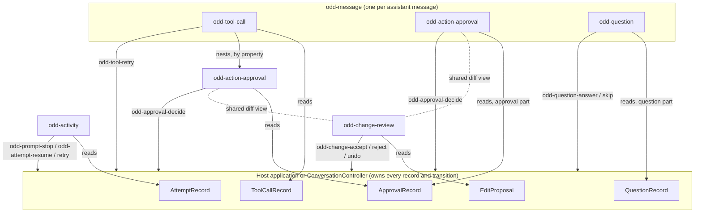

# 0049. Agent workflow elements: one owner per fact, composed around the records

- **Status:** Accepted by the owner on 2026-11-09, with the decisions and corrections of [The owner's decisions](#the-owners-decisions-2026-11-09), which settle every question this record left open (proposed on 2026-11-08). The visual redesign of `odd-action-approval` and its neighbours, and the scope choice's visual composition, wait for the owner's Figma designs (owner, 2026-11-08: "hold off on any new redesigns until those Figmas are drawn"; 2026-11-09).
- **Date:** 2026-11-08; accepted 2026-11-09
- **Area:** `@oddkin/ai`: `odd-action-approval`, `odd-tool-call`, `odd-change-review`, `odd-activity`, `odd-question`, their records, the conversation controller, and the adapters
- **Builds on:** [ai-interaction.md](../ai-interaction.md) §1 (records are host-owned; elements own presentation only), §4.4 to §4.6 (lifecycles); [the component architecture audit](../../research/component-architecture-audit.md) (approved 2026-11-06)
- **Checked against:** `main` at `2a46230` (2026-11-08); the inventory below against `e0e2e97` (2026-11-09)

## The owner's decisions (2026-11-09)

The owner accepted this record with the decisions below. They settle its open questions and the audit's last ones ([the audit](../../research/component-architecture-audit.md) §10), and they supersede the audit's one-beta deprecation (§9 step 7). Agents do not ask for them again.

1. **The five elements stay public and separate** (§3). `odd-action-approval` authorizes a revision of an action; `odd-tool-call` shows invocation, execution, result, failure, and retry; `odd-change-review` shows edits the host applies, with staleness and undo; `odd-activity` shows an attempt's progress and recovery; `odd-question` asks a person for revision-bound information. The host or the conversation controller owns the records and their transitions; the elements render records and send intents, and a click never establishes an outcome. Approval never means the execution succeeded.
2. **Shared inside `@oddkin/ai`, never public** (§4): the read-only diff view, the decision row's presentation, status wording and tone, and the request guard and focus recovery. The approval shows its changes through the read-only view and never embeds an actionable `odd-change-review`. Each element keeps its own actions and lifecycle rules: the decision row is one mechanism configured per element, not one configuration surface for every decision.
3. **The catalog stays stable,** closing the audit's §10:
   - `odd-citation` keeps its inline preview, with its reading order and keyboard and touch access;
   - `odd-container` stays: its constrained or fluid measure and its container-query boundary are a contract `.odd-center` does not have;
   - `odd-transcript` stays public, usable without microphone capture;
   - `odd-ai-label` (composing `odd-disclosure`) and `odd-model-select` (composing `odd-select`) stay public;
   - `odd-message-branch` becomes internal to `odd-message`, keeping the host-owned branch record and the branch-switch intent;
   - `odd-suggestions` is replaced by its tested pattern, Suggested prompts.
4. **Breaking changes land without compatibility layers.** The legacy renderer aliases and the obsolete public registrations go now, each with every affected consumer, example, generated contract, and document. The typed `renderers` convention stays: renderer hooks for record-driven customization, slots for static additions; replacing or disconnecting a renderer runs its cleanup exactly once.
5. **Permission scopes are accepted,** with the rules of §6 item 3.
6. **Questions become conversation records,** as §6 item 4 says.
7. **Ownership, waiting, and withdrawal are corrected** (§5; §6 items 1 and 2): approvals and questions gain a terminal `cancelled`; a generic tool refusal never becomes a person's rejection; the attempt carries a typed wait descriptor; a stream's end is not by itself the attempt's end.
8. **Foundation reuse, and the Figma hold.** Oddkin's primitives are used wherever their semantics fit: the native button sheet for light native actions, `odd-copy-button` for copying, `odd-disclosure` for expandable details, `odd-select`, `odd-input`, `odd-textarea`, `odd-radio-group`, and `odd-checkbox-group` for their controls, and `odd-toolbar`, `odd-badge`, the status marker, `odd-alert`, and the other feedback primitives where they fit; an existing shared module comes before a new one. Context-picker work builds on the existing collection rows, the chips' overflow and review, and the overlay machinery where their contracts fit: reuse guidance, not a new public component or a resource-management application. Visual redesigns of the approval and its neighbouring workflow elements, and the scope choice's visual composition, wait for the owner's Figma. Contracts, controllers, adapters, internal extraction, tests, and documentation go ahead with today's presentation, and question parts compose today's `odd-question`.
9. **Delivery.** The slices of [Where the work stands](#where-the-work-stands-main-e0e2e97-2026-11-09), in that order, in the lanes' ownership with the usual component and `BUDGET` reviews; size measured before and after each slice; the evidence of [§9](#9-verification) recorded per slice. Only the existing adapters change (the AI SDK UI message stream, SSE, and the simulation): a reference to another protocol does not mean a new adapter or an agent runtime. The docs-site pause stays: patterns ship as working examples, composition documents, tests, and agent-kit references, and new site pages wait.

## Where the work stands (main `e0e2e97`, 2026-11-09)

Checked by reading the code on `main`; each commit's own checks are in [verification.md](../../verification.md).

| Work | State | Commits |
| --- | --- | --- |
| `nativeButtonStyles` exported and adopted by the AI elements | Done | `db31f94`, `3188d69` |
| One internal controller for the decision guard and focus recovery (`DecisionController`) | Done | `f7f7e02` |
| Reasoning and `odd-ai-label` composing `odd-disclosure`; `odd-copy-button` in response, message, and artifact | Done | `417c9eb`, `b34a452` |
| `odd-disclosure`'s `summary` slot | Done | `a8c4d33` |
| One typed `renderers` property by extension point, with deprecated aliases | Done; the aliases go in slice 6 | `91dbd42` |
| Eight composition patterns, listed in the agent kits | Done | `e1701fb` |
| `odd-suggestions` and `odd-message-branch` deprecated; `examples/ai-research` on Suggested prompts | Done; their removal is slice 6 | `ab5e05a` |
| `odd-activity` reads only the attempt | Done; the wait descriptor is slice 2 | `7980090` |
| `odd-tool-call` without `awaiting-approval`, its gate worded from its approval | Done; `cancelled` and the refusal correction are slice 2 | `fb7bc38` |
| One decision vocabulary (§5) | Done; `cancelled` is slice 2 | `042413e` |
| The shared diff view and status map, drawn as today | Done | `dadb0ac` |

Still to do: slices 2 to 4, 6, and 7 in this order in Agent 2's lane, and slice 5 beside them in Agent 3's (the rows of the order of work in [IMPLEMENTATION_PLAN.md](../../../IMPLEMENTATION_PLAN.md)).

| Slice | What | Row |
| --- | --- | --- |
| 1 | These decisions and this inventory | Agent 1, 2026-11-09 |
| 2 | `cancelled`; the `tool-denied` correction; the attempt's wait descriptor and the aggregate waiting; the adapters' completion handling (§5; §6 items 1 and 2) | Agent 2, item 15 |
| 3 | Permission scopes and questions in the conversation: contracts, controller, and transports (§6 items 3 and 4) | Agent 2, item 16 |
| 4 | The shared decision row, configured per element, with today's presentation (§4); the refinements of `odd-tool-call` and `odd-question` that keep it | Agent 2, item 17 |
| 5 | The audit's other refinements (`odd-task-plan`, `odd-inline-assist`, `odd-artifact`, `odd-response-feedback`, `odd-model-select`), tests for the kept contracts (`odd-citation`, `odd-transcript`), and `odd-context-picker` | Agent 3, items 9 and 10 |
| 6 | The renderer aliases, the public registrations of `odd-message-branch` and `odd-suggestions`, and the unused deprecated strings removed, with every consumer | Agent 2, item 18 |
| 7 | Patterns, examples, generated contracts, and agent kits brought in line | Agent 2, item 19 |

Waiting for the owner's Figma: the visual redesign of `odd-action-approval` and its neighbouring workflow elements (§8), the decision row's new look with it, the scope choice's visual composition, and the audit's step 4 refinements of `odd-tool-call` (`odd-badge` for its status, `odd-disclosure`) and `odd-question` (the composed form controls), since each changes their look (slice 4). Done by no slice, and recorded as limitations: user testing, testing with real assistive technology, and the docs site's Patterns pages (docs pause). *Update, 2026-11-09: the shared parts and the approval are drawn (below).*

## The design specs (Figma pages 07 to 09, reviewed 2026-11-09)

The owner's design pages in `E7LfRysny8V3qU24tv082i`: "07 · AI redesign · Index" (`805:2`), "08 · AI · Shared parts · Interaction spec" (`805:3`), and "09 · AI · Action approval · Interaction spec" (`805:4`), drawn against `main` at `0350306`. Pages 10 to 30 are not started: the designer stopped after 09 for review. Agent 1 read them on 2026-11-09 (text, component sets, and two screenshots).

**How the elements are built.** Each public element composes internal parts, and the code mirrors them in `packages/ai/src/internal/`. Nothing public is added: no new tags, properties, slots, renderers, events, or CSS custom properties; only new localized strings for the proposed copy.

| Figma internal part (`Oddkin/AI/Internal/...`) | Code | Used by |
| --- | --- | --- |
| `Status`: a compact badge for the state, an outcome line for what it means | `status.ts` | All of them |
| `DecisionRow/Approval`, `/Question`, `/ChangeReview`, `/Checkpoint`, `/ReviewUndo`, `/ReviewDismiss`, `/CheckpointConfirmation`: one mechanism, a setup per operation | `decision-row.ts` on `decision.ts` | Approval, question, change review, checkpoint |
| `ScopeChoice` and `ScopeOption` | A scope-choice module, moved out of `action-approval` | Approval |
| `DiffView`, read-only | `diff-view.ts` | Approval, change review |
| `Expiry` and `Waiting` | `formatTime`, and the activity's wait wording | Approval, question; activity |
| `ReasonField`: `odd-textarea` inside `odd-disclosure` | The approval's reason: a native textarea drawn by the components' field sheets (`fieldStructuralStyles`, `controlStyles`), with `odd-textarea`'s four rows and vertical resize and a programmatic label, inside `odd-disclosure`. Not `odd-textarea` itself: its form-control stack would cost the chat bundle 3,328 B gzip against 759 for the same behaviour, as with the scope radios (row 20, 2026-11-09, Agent 1) | Approval |
| `BadgePresentation`, `DisclosureTrigger` | None: Figma-only adapters of `odd-badge` and `odd-disclosure` | — |

**What the specs add.** The status badge with an outcome line, and attention badges for `requested`, `expired`, and needs-input. Focus that stays on the chosen control while sending, moves to the outcome line (`tabindex=-1`) only when the focused control goes away, and never lands on Undo by itself. A restored `submitting` record with no local choice shows generic pending wording and loads no button. The approval laid out by its container: below 480 px compact (16 px padding, stacked 48 px controls), 480 to 719 px full (24 px padding), from 720 px a 640 px default capped at 720 px. Tab order diff, scope, reason, Approve, Reject, Edit, and no Enter-to-approve shortcut. `announce` off by default. Without `approvalScopes`, Approve is blocked and Reject stays; a confirmed scope comes only from the host record ("Scope details were not supplied." when it is missing). Absent change sides are omitted, an empty string is shown as an empty value, and no record renders nothing. The diff's context opens in a disclosure; long diffs sit in a disclosure with a 240 px scroll region; split views stack below 480 px. Expiry is omitted when absent or unformattable, and nothing counts down.

**Decisions on the designer's open questions** (proposed by Agent 1 and approved by the owner, 2026-11-09):

- Pages 07 to 09 are the build spec, and the designer continues with pages 10 to 30.
- Scopes: described radio rows (option A) for two to four scopes, a select with the chosen scope's description (option B) above four; the compact option C is not used by default.
- The approval's optional reason collapses into a disclosure when empty, stays open once written, and resets with a new revision.
- Expiry is emphasized as soon five minutes before `expiresAt`: an Oddkin default that never changes the record.
- A line diff is long above 10 changed lines, a replaced line counted once (`LONG_DIFF_LINES` in `packages/ai/src/internal/diff-view.ts`): it waits behind its count and scrolls in a 240 px region when open. Word diffs never wait, since prose reflows. An Oddkin default (Agent 1, 2026-11-09), for the designer to change with page 11 (change review).
- The approval shows its changes as Before and After blocks, as drawn, and gains no `granularity` property (replacing that part of §6 item 3).
- Attention badges for `requested`, `expired`, and needs-input are added; outcome wording stays neutral.

**Deliberate differences from the pages** (Agent 1, 2026-11-09): a disclosure's summary stays above its content while open, as the WAI-ARIA disclosure pattern and native `
` keep it, where page 08 draws the diff view's "Hide context" below the change: moving it would move the control just used.

**Gaps.** The design records the pages cite (`C:\SLT_Backup_10-21-2026\ai-redesign\*.json`) are not on disk. The Figma-only adapters exist because the badge, textarea, and disclosure specimens on pages 02 and 03 have fixed geometry: making those primitives responsive in Figma is the owner's follow-up, followed by a snapshot refresh (Agent 1).

**Pages 10 to 14 (2026-11-10).** The owner approved page 11 (the change review) on 2026-11-09 and page 10 (the tool call) on 2026-11-10; pages 12 to 14 await review. The owner asked Agent 1 to settle the four open questions of pages 11 to 14 from research on shipped products and published guidance:

- **Page 11, Apply and Undo failures:** the error names the operation that failed and says what the host confirmed, never more; the decision row keeps its buttons, so trying again is the same Apply or Undo. No generic Retry and no new status. Error-message guidance asks for precise, constructive messages that keep the person's work, never "An error occurred" ([NN/g](https://www.nngroup.com/articles/error-message-guidelines/), [GOV.UK](https://design-system.service.gov.uk/components/error-message/)); VS Code keeps Keep and Undo beside each change ([VS Code](https://code.visualstudio.com/docs/agents/run/review-code-edits)).
- **Page 12, responses on their way:** a response stays "is being recorded" until the host confirms it: "1 response is being recorded. 2 requests still need your input." The page 08 wording already built ("1 response recorded.") claims a confirmation that has not happened, so it changes too. Status must show the system's actual state ([NN/g](https://www.nngroup.com/articles/visibility-system-status/)).
- **Page 13, a blank Other:** a selected Other with no text is an error even beside other choices, and the draft stays. A conditionally revealed question is answered when its option is selected, each error state has its own message, and no field is cleared ([GOV.UK checkboxes](https://design-system.service.gov.uk/components/checkboxes/), [GOV.UK error message](https://design-system.service.gov.uk/components/error-message/)).
- **Page 14, the restore confirmation:** focus goes to Keep current state, the least destructive action, with the confirmation's text as its description; if the checkpoint or its scope changes while confirming, the confirmation closes, says why, and focus returns to Restore. Restoring is not easily reversed ([WAI-ARIA APG dialog](https://www.w3.org/WAI/ARIA/apg/patterns/dialog-modal/), [alert dialog](https://www.w3.org/WAI/ARIA/apg/patterns/alertdialog/)); VS Code asks to confirm before Restore Checkpoint removes later requests, and Claude Code's rewind offers Never mind beside each restore ([VS Code](https://code.visualstudio.com/docs/agents/run/review-code-edits), [Claude Code](https://code.claude.com/docs/en/checkpointing)).

**Rows.**

| What | Row |
| --- | --- |
| The shared parts of page 08, for all four decision elements | Agent 2, item 20 |
| `odd-action-approval` to page 09 | Agent 2, item 21 |
| The page 08 and 09 families exported into the design snapshot, for the parity tests | Agent 1, item 6: done on 2026-11-09 |
| `odd-change-review` to page 11 (approved by the owner, 2026-11-09), and its family in the snapshot | Agent 2, item 24; Agent 1, item 7 |
| `odd-tool-call` to page 10 (approved by the owner, 2026-11-10), and its family in the snapshot | Agent 2, item 25; Agent 1, item 8 |
| `odd-activity`'s wording for responses on their way (page 12's answered question) | Agent 2, item 26 |
| Agent 3's visual refinements of item 9 | Wait for their pages (20, 21, and 26 to 28); the `odd-citation` and `odd-transcript` tests go ahead |
| Pages 12 to 30 | The owner's design session, then one implementation row per approved page |

## Context

The owner asked, before `odd-action-approval` is redesigned, whether the five elements that carry an agent's work and a person's part in it form one vocabulary or five overlapping ones. Oddkin has no production users, so breaking changes are allowed when they make the architecture clearer, without compatibility layers.

### The records today

Every one of these elements renders host-owned records and sends intents; none keeps workflow state of its own ([ai-interaction.md](../ai-interaction.md) §1). The records are:

| Record | Where | Status values |
| --- | --- | --- |
| `ToolCallRecord` | [contracts/models.ts:122–152](../../../packages/ai/src/contracts/models.ts#L122-L152) | `input-streaming`, `input-available`, `awaiting-approval`, `executing`, `output-available`, `output-error`, `denied`, `cancelled`; `approvalId` links its approval |
| `ApprovalRecord` | [contracts/models.ts:164–191](../../../packages/ai/src/contracts/models.ts#L164-L191) | `requested`, `decision-pending`, `approved`, `rejected`, `expired`, `superseded`, `decision-failed`; `toolCallId` links its tool call; `changes` is a list of before and after strings |
| `QuestionRecord` | [contracts/models.ts:284–311](../../../packages/ai/src/contracts/models.ts#L284-L311) | `requested`, `submitting`, `submitted`, `skipped`, `expired`, `failed`; not part of `ConversationState` and not a message part |
| `EditProposal` | [controllers/document.ts:82–117](../../../packages/ai/src/controllers/document.ts#L82-L117) | `proposed`, `accept-pending`, `applied`, `rejected`, `stale`, `undo-pending`, `undone`, `failed`; edits the host applies to a document it owns |
| `AttemptRecord` | [contracts/types.ts:81–96](../../../packages/ai/src/contracts/types.ts#L81-L96) | `submitted`, `accepted`, `streaming`, `awaiting-input`, `completed`, `cancelled`, `failed`, `interrupted`, with the connection and stop states beside them |

### The elements today

| Element | Renders | Sends | Composes |
| --- | --- | --- | --- |
| `odd-action-approval` ([action-approval.ts](../../../packages/ai/src/action-approval/action-approval.ts)) | One `ApprovalRecord`: title, summary, target, risk, expiry, `changes` as `<del>`/`<ins>` text, status text, a reason field, Approve, Reject, Edit | `odd-approval-decide` (`approvalId`, `revision`, `toolCallId`, `decision`, `reason`), `odd-approval-edit`, `odd-announce` | `odd-button`; the internal `DecisionController` |
| `odd-tool-call` ([tool-call.ts](../../../packages/ai/src/tool-call/tool-call.ts)) | One `ToolCallRecord`: name, purpose, status, arguments, result or error, Retry | `odd-tool-retry` | `odd-action-approval`, from its `approval` property, after its own body ([tool-call.template.ts:58–64](../../../packages/ai/src/tool-call/tool-call.template.ts#L58-L64)) |
| `odd-change-review` ([change-review.ts](../../../packages/ai/src/change-review/change-review.ts)) | `EditProposal[]`: word or line diffs, inline or split, context; Accept, Reject or Dismiss, Undo | `odd-change-accept`, `odd-change-reject`, `odd-change-undo`, `odd-announce` | `odd-button`; `diffWords`/`diffLines` from [controllers/diff.ts](../../../packages/ai/src/controllers/diff.ts) |
| `odd-activity` ([activity.ts](../../../packages/ai/src/activity/activity.ts)) | One `AttemptRecord` and its `tools`: one status line; Stop, Resume, Retry | `odd-prompt-stop`, `odd-attempt-resume`, `odd-attempt-retry` | Native buttons |
| `odd-question` ([question.ts](../../../packages/ai/src/question/question.ts)) | One `QuestionRecord`: choices, a form, or free text; Answer, Skip | `odd-question-answer`, `odd-question-skip`, `odd-announce` | Native form controls; the internal `DecisionController` |

`odd-message` renders a `tool-call` part as `odd-tool-call`, looking up its approval by `tool.approvalId`, and an `approval` part as a standalone `odd-action-approval` ([message.template.ts:51–67](../../../packages/ai/src/message/message.template.ts#L51-L67)). The conversation controller puts an approval with a `toolCallId` on that tool call and moves the tool to `awaiting-approval`; an approval without one becomes an `approval` part ([conversation.ts:1016–1031](../../../packages/ai/src/controllers/conversation.ts#L1016-L1031)).

## What overlaps

| # | Overlap | Evidence | Effect |
| --- | --- | --- | --- |
| O1 | **Two records state one gate.** A tool's `awaiting-approval` and `denied` repeat what its approval's status says. | The controller moves the tool to `awaiting-approval` when the approval is requested ([conversation.ts:1021](../../../packages/ai/src/controllers/conversation.ts#L1021)) but never moves it when the approval resolves; only the adapter's next tool event does (`tool-denied`, [ui-message-stream.ts:312–314](../../../packages/ai/src/stream/ui-message-stream.ts#L312-L314)). | Between a decision and the adapter's next tool event, `odd-tool-call` says "Waiting for approval" above its own approval saying "Approved" or "Rejected", and `odd-activity` says "Waiting for approval" too. Two components contradict each other because two records hold one fact. |
| O2 | **A cross-record derivation in `odd-activity`.** | `_text()` scans `tools` for `awaiting-approval` ([activity.ts:80](../../../packages/ai/src/activity/activity.ts#L80)). | The run status depends on another element's record semantics, and it misses approvals outside tool calls and every question, although `AttemptStatus` already has `awaiting-input`. |
| O3 | **Two renderings of before and after.** | `odd-action-approval` prints `changes` as "Before: …"/"After: …" text ([action-approval.template.ts:45–58](../../../packages/ai/src/action-approval/action-approval.template.ts#L45-L58)); `odd-change-review` has word and line diffs, merged runs, context, inline and split views. | A proposed file write needs the review surface the approval cannot show, and the two drift apart. |
| O4 | **Four decision rows, built four times.** | Approve/Reject/Edit with a reason; Accept/Reject/Dismiss/Undo; Answer/Skip; Restore (checkpoint). Only the request guard and focus recovery are shared (`DecisionController`, since row 11). | Pending, disabled, loading, and failure presentation differ element by element. |
| O5 | **Three vocabularies for one lifecycle.** | Waiting for a person: `requested` (approval, question), `proposed` (proposal). In flight: `decision-pending`, `submitting`, `accept-pending`. Request failed: `decision-failed`, `failed`. | Hosts map the same idea three ways, and the status presentation cannot be shared. |
| O6 | **Status shown three ways.** | Toned text in the tool's summary, a toned paragraph in the approval, a status part per proposal, plain text in the question and the activity. | No consistent status reading across the vocabulary (the audit's row 12 already moves the tool's status to `odd-badge`). |
| O7 | **Human input enters the flow two ways.** | An approval is a record in `ConversationState` and a message part; a question is neither, so the host places `odd-question` outside the message flow and wires it by hand. | "An agent asks, then proposes" cannot be shown in order without host plumbing. |
| O8 | **No permission scope.** | `ApprovalRecord` and `ApprovalDecision` carry one decision for one revision; nothing lets a person approve "for this conversation" or "always for this tool". | Hosts that need it build a second approval UI. |

Not overlaps, after checking:

- **Approval and change review** decide different things: an approval authorizes an action that someone else executes (the agent's backend, a tool); a change review accepts edits that the host applies itself to a document it owns (`DocumentSession`). They share a review surface (O3), not a lifecycle.
- **Tool call and approval** stay separate records: an approval can exist without a tool call (`approval` parts: sending mail, spending money), and a tool call without an approval.
- **Activity and tool call** answer different questions: what the run is doing now, and what one call did.

## Decision

### 1. One owner per fact

The host, or the `ConversationController` acting for it, owns every record and every transition. Each fact lives in exactly one record; an element shows facts and derives presentation from the records it is given, never stores a copy, and never reaches into another element.

| Fact | Owner (record) | Presented by | Never stored in |
| --- | --- | --- | --- |
| May the action run? (authorization) | `ApprovalRecord.status` | `odd-action-approval`; `odd-tool-call` reads it to word its own gate | `ToolCallRecord` |
| What will change? (review) | `ApprovalRecord.changes` for an action; `EditProposal` for a host-applied edit | The shared diff view (§4) inside each | Either element's state |
| Did it run, and with what result? (execution) | `ToolCallRecord.status`, `output`, `error` | `odd-tool-call` | `ApprovalRecord` (approval never means success, §4.5) |
| What is the run doing? (progress) | `AttemptRecord` | `odd-activity` | `ToolCallRecord` scans |
| What does the agent need to know? (human input) | `QuestionRecord` | `odd-question` | Host-local state |

### 2. The relationships

- **Nested:** a tool call shows its own approval, because the approval gates that call. It is the one nesting in the vocabulary; it uses the `approval` property, not a slot, so there is one way to do it.
- **Siblings in the message flow:** a standalone approval (`approval` part) and a question (a new `question` part, §6 item 4) appear where the agent produced them, in order.
- **Outside the message:** `odd-activity` is the run's status bar; `odd-change-review` sits by the document it edits.
- **No element contains another's decision controls.** An approval never contains an `odd-change-review` (two decisions for one action would contradict); it shows its changes read-only through the shared diff view.

### 3. Each element's place

| Element | Classification | Disposition | Responsibility it keeps | What it gives up |
| --- | --- | --- | --- | --- |
| `odd-action-approval` | Specialized primitive | Refine | Authorization of one revision of one action: what, where, how risky, until when, which changes, and for which scope; the decision request and its outcome | Its own before and after rendering (to the shared diff view); its own decision row (to the shared one) |
| `odd-tool-call` | Composite | Refine | The invocation lifecycle: arguments, execution, result or error, retry; nesting its approval | The `awaiting-approval` status (derived from the approval) |
| `odd-change-review` | Composite | Refine | Review of edits the host applies to its own document: revisions, stale proposals, undo | Its private diff rendering, which becomes the shared view |
| `odd-activity` | Specialized primitive | Refine | The current run's status and its recovery actions | Scanning tool calls; "waiting" comes from the attempt alone |
| `odd-question` | Composite | Refine | Information the agent asks for, bound to a revision | Its place outside the message flow |

None is consolidated, internalized, or turned into a pattern:

- **Merging the approval into the tool call** would leave approvals outside tool calls without an element.
- **Merging the change review into the approval** would mix an action someone else runs with edits the host applies, which have different lifecycles (undo, staleness against the document).
- **Turning the activity into a pattern** would push the stop, resume, and retry rules into every application.

Each element earns its place through a contract (a revision-bound decision, an execution lifecycle, a document's revisions, a run's recovery), not through its layout.

### 4. Shared internals, not new public elements

These interactions repeat across the five. Each becomes one internal module of `@oddkin/ai`, used by every element that needs it. None becomes a public element: the components catalog does not grow (owner, 2026-10-29), and no consumer needs them outside these elements.

| Shared interaction | Module (internal) | Used by |
| --- | --- | --- |
| Read-only diff view: word or line diffs, merged runs, context, inline or split, `<del>`/`<ins>` with visually hidden labels; it renders change data and decides nothing | `internal/diff-view.ts`, moved out of `odd-change-review` (`mergeRuns`, the diff template and styles), on `controllers/diff.ts` | `odd-change-review`, `odd-action-approval` (`changes`) |
| Decision row: `odd-button`s, as today (the native button sheet has no loading state), the chosen button loading while the request is in flight, the others disabled, focus kept by `DecisionController`. Each element configures its own actions, button size, and which buttons show loading, so today's presentation stays until the redesign (owner, 2026-11-09). *Row 20 (2026-11-09): page 08's presentation replaced it: the medium size, page 08's appearances, the chosen button loading for each request, buttons keyed by action, and the error, pending, reason, and outcome lines in one stack.* | `internal/decision-row.ts`, beside `internal/decision.ts` | `odd-action-approval`, `odd-question`, `odd-change-review`, `odd-checkpoint` |
| Status: one vocabulary (§5) and one map from status to tone; `odd-badge` for compact status, a toned line for an outcome | `internal/status.ts` | All five, and `odd-checkpoint` |
| Expandable details | `odd-disclosure` (public, in `@oddkin/components`; its `summary` slot since row 12) | `odd-tool-call`; `odd-action-approval` for long changes |
| Expiry and times | `formatTime` (exists) | `odd-action-approval`, `odd-question` |

### 5. One lifecycle vocabulary for a person's decision

| Meaning | Approval | Question | Edit proposal (host-applied, so it keeps apply and undo) |
| --- | --- | --- | --- |
| Waiting for the person | `requested` | `requested` | `requested` (was `proposed`) |
| Request in flight | `submitting` (was `decision-pending`) | `submitting` | `applying` (was `accept-pending`), `undoing` (was `undo-pending`) |
| The request failed; the person may decide again | `failed` (was `decision-failed`) | `failed` | `failed` |
| Resolved | `approved`, `rejected` | `answered` (was `submitted`), `skipped` | `applied`, `rejected`, `undone` |
| No longer decidable | `expired`, `superseded` | `expired`, `superseded` (new: a newer revision replaced it) | `stale` |
| Withdrawn by the host or backend, or the action or attempt can no longer run (terminal) | `cancelled` (new, owner, 2026-11-09) | `cancelled` (new, owner, 2026-11-09) | — |

`rejected` is a person's explicit decision, `expired` an expiry, `superseded` a replacement by a newer revision, and `cancelled` a withdrawal; they stay distinct.

Every intent event names its record and revision: `{ approvalId, revision, … }`, `{ questionId, revision, … }`, `{ proposalId, … }`. `odd-approval-decide` drops `toolCallId`: the host reads it from the record, so the event no longer carries a second copy.

### 6. Required changes

1. **`ToolCallRecord.status` loses `awaiting-approval`** (done, `fb7bc38`). Before the tool runs, `odd-tool-call` words its gate from its approval:
   - unresolved (`requested`, `submitting`, `failed`): "Waiting for approval";
   - `rejected`, `expired`, `superseded`, or `cancelled`, before the tool ran: "Not run".
   
   Execution progress and results still come from the tool record. The controller links the approval (`approvalId`) without moving the tool. `denied` stays: the backend refusing to run the call. **Correction (owner, 2026-11-09):** a generic `tool-denied` never manufactures a person's rejection. When the action can no longer run, the controller withdraws a linked approval that is still unresolved (`cancelled`) and leaves a terminal decision as it is; an adapter whose protocol carries an explicit, authoritative authorization rejection reports that approval outcome separately. An approval followed by a failed execution stays `approved`.
2. **The attempt owns waiting** (`odd-activity` reads only the attempt since `7980090`). Tool records may name the running tools, but `odd-activity` never scans them for human input. The controller keeps the aggregate across every live approval and question of the attempt in a small typed wait descriptor on the attempt, which tells input that needs the person's action from responses being submitted. It recomputes the descriptor after every request, submission, failure, retry, resolution, replacement, and withdrawal, so one resolution never clears another open request. When the last request resolves, the attempt takes the latest authoritative run phase: approval does not mean executing or completed. A stop request, a disconnected transport, or an ended message is not a terminal attempt: where the protocol represents a paused workflow, an approval or a question followed by the stream's completion stays answerable. Only a terminal attempt withdraws its open requests (`cancelled`).
3. **`ApprovalRecord`:**
   - `changes` render through the shared read-only diff view, as Before and After blocks; the approval gains no `granularity` property (owner, 2026-11-09, from the design specs);
   - **permission scopes** (owner, 2026-11-09): optional `scopes`, `[{ id, label, description? }]` with opaque ids, and `defaultScopeId`, offered by the host, whose backend defines, validates, enforces, and persists what each scope means. The element collects intent only: no permission storage, authentication, or policy engine.
     - No scopes, or an empty list: the approval covers this action at this revision only.
     - One scope: no selector, and the scope stays visibly explained.
     - Two or more: the person chooses, unless the host gives an explicit, valid `defaultScopeId`; nothing is chosen because it comes first.
     - Duplicate ids and an unknown default are invalid configuration.
     - The chosen scope goes only with `approve` (a rejection never sets a broader denial), in `odd-approval-decide` and the transport's `ApprovalDecision`, validated against the current revision.
     - A material change to the action, its target, or the scopes offered makes a new revision, which resets the local choice.
     - A transport that cannot carry a scope reports a capability limitation or fails explicitly; it never drops the choice.
   - the status renames of §5, and `cancelled`.
4. **Questions are conversation records** (owner, 2026-11-09):
   - `questions` in `ConversationState` and ordered `question` message parts, with stable record and part identity, in snapshots and restores;
   - normalized adapter events for a question's request and resolution;
   - `ConversationController.answer()` and `skip()`, bound to `odd-question-answer` and `odd-question-skip` like `odd-approval-decide`;
   - the transport's optional answer operation, typed to tell an answer from a skip: skipping is never an empty answer;
   - each request and outcome bound to its attempt and revision; message order kept; replayed events deduplicated; a late result never touches a newer attempt or question revision;
   - a transport without human input says so rather than report an answer;
   - `odd-question` stays usable on its own with host-owned records; the conversation is one more composition.
   
   The existing adapters map their protocol's way of asking to these events. The renames of §5 apply.
5. **The shared modules of §4,** with `odd-change-review`'s statuses renamed (§5): the diff view and the status map (done, `dadb0ac`), then the decision row, configured per element, with today's presentation (done, `d1809a61`; owner, 2026-11-09, replacing the note of 2026-11-08 that moved it to the redesign).
6. **Documentation and generated contracts:**
   - ai-interaction.md §3, §4.4 to §4.6, and §6.1;
   - the element references, the agent kits, the composition catalog, and `docs/diagnostics.md`;
   - the patterns "Approval outside a tool call" and a new "Agent asks, then acts" (below).
   
   No compatibility layers (owner, 2026-11-08 and 2026-11-09): each rename and removal lands with its consumers, examples, generated contracts, and tests.
7. **Public API reductions** (owner, 2026-11-09): the renderer aliases of `odd-conversation`, `odd-message`, and `odd-tool-call`, the public registrations of `odd-message-branch` and `odd-suggestions`, and the unused deprecated strings of `odd-change-review` and `odd-checkpoint` go, each with its consumers.

### 7. Compositions for applications

Each is a pattern page with a working example, in the format of the audit's §7. In every one the application owns the records and the agent's execution.

| Scenario | Who owns what | What shows it | How they talk |
| --- | --- | --- | --- |
| A tool call that needs approval | Tool call: execution. Approval (`toolCallId`): authorization | `odd-tool-call` nesting `odd-action-approval` | `odd-approval-decide` → host → transport `decide` → the approval resolves; the backend's tool events move the tool |
| A proposed file change that needs review and authorization | The approval, with `changes` (`granularity: 'lines'`) | `odd-action-approval` alone, or nested in the write tool's call | One decision; the diff is read-only. `odd-change-review` is not used: the host does not apply the edit |
| A run with several approvals | Each approval its own record; the attempt is `awaiting-input` | `odd-activity` "Waiting for you"; each approval in the message flow | Each decision independent; the run continues when the backend has what it needs |
| A question that shapes the next action | Question, then a later approval | `question` part, then an `approval` or `tool-call` part, in order | Answer → host → backend; the backend proposes the action |
| A rejected action returned for revision | The approval: `rejected` with the reason, then the same `approvalId` at revision + 1, `requested` | The same `odd-action-approval`, which resets for the new revision | The reason goes to the agent with the rejection; the old decision cannot apply to the new revision |
| An approved action whose execution fails | Approval `approved` (it stays so); tool `output-error` | The approval's "Approved", the tool's error and Retry (when `retryable`) | `odd-tool-retry` → host; a retry does not ask again unless the host issues a new revision |
| A request withdrawn before anyone decided | The approval or question: `cancelled` by the host or backend, or because its action or attempt can no longer run | Its status line; no decision is offered | Nothing to send; the attempt's wait descriptor drops it |
| A workflow that pauses for input | The attempt waits (its descriptor names the open approvals and questions); the stream may end | `odd-activity` reading the attempt; each request in the message flow | Each answer or decision → host → backend, which resumes the run |

### 8. What this means for `odd-action-approval`

- **Its job:** authorizing one revision of one action, and nothing else. It never reports execution: inside `odd-tool-call` the call reports that, and a standalone approval says only that the decision was recorded.
- **Its anatomy,** for the owner's Figma redesign, in reading order:
  1. the title, with the risk as an `odd-badge` and the expiry;
  2. the summary;
  3. the target;
  4. the changes (the shared diff view, collapsible with `odd-disclosure` when long);
  5. the scope choice when two or more scopes are offered, or the one scope's explanation (its visual composition waits for the owner's Figma);
  6. the reason;
  7. the shared decision row (Approve, Reject, Edit when allowed);
  8. one status line.
- **Its API after the change:**
  - properties: `approval`, `capabilities`, `announce`, `strings`;
  - events: `odd-approval-decide` (`approvalId`, `revision`, `decision`, `reason?`, and `scope?` with `approve` only), `odd-approval-edit`, `odd-announce`;
  - parts: `base`, `changes`, `actions`, and `scope`.
- **What it does not do:**
  - It does not draw its own diff, decision row, or status styles: those come from §4.
  - It does not nest `odd-change-review`.
  - It does not read tool or attempt records.

### 9. Verification

Each slice records its observed results in [verification.md](../../verification.md) and covers what it touches of this list (owner, 2026-11-09), with the controller tests, the affected browser tests in Chromium, Firefox, and WebKit, the Figma parity checks for unchanged presentation, and the repository's gates:

- duplicate decisions and stale revisions; a remote resolution arriving before the local acknowledgment; revision replacement, reset and disposal, and a promise that completes late;
- two approvals and a question, resolved in different orders;
- an approval accepted before execution; an approved execution that fails; a backend refusal; an explicit rejection;
- cancellation, expiry, and supersession;
- invalid or unsupported scopes, an absent default, and the scopes changing during a submission;
- a question's answer and skip failing, retry, ordering, replay, and snapshot restoration;
- a protocol stream ending while human input is still pending;
- the shared diff view's modes and its accessible insertion and deletion labels;
- focus recovery, announcements made once, and form validation through shadow roots;
- renderer cleanup on replacement and disconnection;
- the removed public entry points and registrations gone.

Schemas, manifests, enriched metadata, the composition catalog, registrations, and agent kits are regenerated by their generators. Size is measured before and after each slice, and a justified increase follows the `BUDGET` procedure. Implementation evidence is kept apart from what is deferred: user testing, testing with real assistive technology, and the Figma-dependent work.

## Consequences

- One fact, one record: `odd-tool-call`, `odd-activity`, and `odd-action-approval` can no longer contradict each other about whether an action may run.
- Breaking:
  - the tool, approval, question, and proposal statuses of §5 and §6, `cancelled` included;
  - `odd-approval-decide`'s detail (`toolCallId` gone; `scope` with `approve`);
  - the conversation state shape (`questions`) and the attempt's wait descriptor;
  - the renderer aliases and the public `odd-message-branch` and `odd-suggestions` (§6 item 7).
  
  The AI demos, examples, patterns, tests, and the AI SDK adapter change with them. Oddkin has no production users, and these land without aliases.
- Size: the shared modules replace private copies; the scope choice and the question part add code. Each landing measures `ai-chat` and posts `BUDGET` (owner, 2026-11-06).
- Out of scope:
  - a general agent runtime;
  - shared global state;
  - a public diff, decision-row, or status element.
  
  The application keeps its state and its agent's execution.

## Settled by the owner (2026-11-09)

- **Permission scopes (§6 item 3):** accepted, with the rules there.
- **Questions in the conversation (§6 item 4):** accepted.
- **The visual redesign** of `odd-action-approval` (§8), the decision row's new look, and the scope choice's visual composition follow the owner's Figma.
